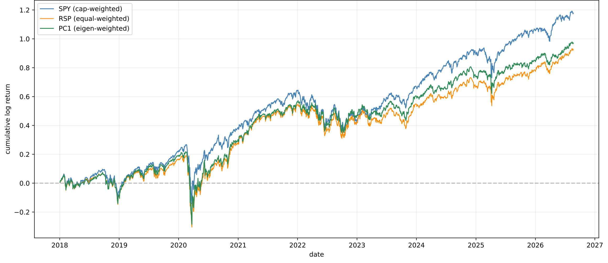

# EWMA Principal Eigenportfolios of Equity Returns

**Market Representation and Beta-Hedging Performance**
Andrew Kangmin Kim (University of Oxford), Aurora Neyan Zhou (University of Warwick)

[](https://arxiv.org/abs/2611.20363) · [Paper (PDF)](paper/EWMA_PC1.pdf)

## Question

Can a market portfolio *estimated from the data*, the leading principal component of an exponentially
weighted second-moment matrix of S&P 500 returns, hedge equity portfolios better than the ETFs people
actually use, SPY (cap-weighted) and RSP (equal-weighted)?

## Answer

- **The leading component is the market.** It is a broad, almost entirely long portfolio: a median of
  472 names, 100% positive weights, and the top ten holding only 4.06%. It explains a median 29.3% of
  second-moment variation and correlates 0.925 with SPY and 0.993 with RSP.
- **It beats SPY as a hedge in every configuration**, on both variance reduction and residual co-movement.
- **Against RSP the edge is small and mixed.**

| Mean variance reduction (%) | Stocks | SPY | RSP | PC1 |
|---|---|---|---|---|
| Single stock | 1 | 30.80 | 35.45 | **35.72** |
| Dirichlet weights | 50 | 79.03 | 91.93 | **92.17** |
| Liquidity-tilted weights | 50 | 80.93 | **83.65** | 82.99 |

Each cell averages 1,000 random portfolios drawn from the historical S&P 500 universe, 2018–2026.
Inference uses a paired stationary block bootstrap. Results are gross of trading, financing and
borrowing costs.



## Method

1. **Universe.** Point-in-time S&P 500 membership, which includes names later removed from the index
   and so reduces survivorship bias. Delisted tickers Yahoo no longer serves are necessarily missing.
   Prices from Yahoo Finance, 2015–2026.
2. **Standardise.** Each return is divided by its lagged EWMA volatility (60-day half-life) and
   clipped at ±10σ.
3. **Estimate.** A streaming, uncentred EWMA second-moment matrix (252-day half-life). Its leading
   eigenvector, rescaled to sum-to-one weights, is the PC1 portfolio. The first 756 days are burn-in.
4. **Hedge.** Random 1-, 10-, 20- and 50-stock portfolios are drawn with Dirichlet or liquidity-tilted
   weights. Each is beta-hedged with PC1, SPY or RSP using one common exposure-estimation rule.
5. **Evaluate.** Percentage variance reduction, and average pairwise residual correlation across
   portfolios, with paired block-bootstrap intervals.

Full details are in Section 3 of the [paper](paper/EWMA_PC1.pdf).

## Repository layout

```
paper/EWMA_PC1.pdf                      the paper (arXiv version)
notebooks/latent_market_drift_v2.ipynb  Part 1: universe, EWMA-PCA, the PC1 portfolio
notebooks/pc1_beta_hedge_v2.ipynb       Part 2: the hedging experiment
results/hedge_results.json              every hedging result; Tables 2-6 are built from it
results/diag.parquet                    daily PC1 diagnostics; Table 1 summarises it
results/logs/                           full console output of the runs behind the paper
figures/fig1_cumulative.png             Figure 1
scripts/run_notebook.py                 runs a notebook cell by cell, headless
data/                                   input snapshots (not committed; see data/README.md)
```

### Where each part of the paper comes from

| Paper | Notebook cells |
|---|---|
| Table 1 (PC1 characteristics) | Part 1, cells 1–12 (diagnostics written to `results/diag.parquet`) |
| Figure 1 (cumulative returns) | Part 1, cell 13 |
| Table 2 (mean variance reduction) | Part 2, cells 1–4 (writes `results/hedge_results.json`) |
| Tables 3–4 (variance-reduction percentiles, squared-residual bootstrap) | Part 2, cell 7 |
| Table 5 (residual correlation) | Part 2, cell 5 |
| Table 6 (residual-correlation bootstrap) | Part 2, cell 6 |
| Correctness checks | Part 1, cell 19; Part 2, cell 12 (acceptance tests that run on every execution) |

Some cells hold exploratory analyses that are **not reported in the paper**:

- Part 1, cells 14–18 and 20–21: eigenvector drift, divergence across horizons, the spectrum, a 2020
  close-up, the loading trajectory, spectral separation.
- Part 2, cells 8–11: spanning tests, year and volatility-regime splits, costs.

They are left in place because the acceptance tests use some of their intermediate values.

## Reproducing

Run from the repository root, because the notebooks use paths relative to the working directory:

```bash
pip install -r requirements.txt
python scripts/run_notebook.py notebooks/latent_market_drift_v2.ipynb   # Part 1, then
python scripts/run_notebook.py notebooks/pc1_beta_hedge_v2.ipynb        # Part 2
```

The notebooks can also be run top to bottom in Jupyter, as long as Jupyter is started from the repo
root. Part 2's bootstrap (cell 6) takes about two hours. Both notebooks read from, and write to,
`./data`, and save figures to `./figures`. The
first run downloads S&P 500 membership from Wikipedia and prices from Yahoo Finance and caches them as
snapshots. Later runs reuse the snapshots and never overwrite them.

**A fresh download will not reproduce the paper's numbers exactly.** Yahoo's coverage of delisted
tickers changes from day to day (the same request returned 121 missing tickers on one day and 134 on
another), and the Wikipedia pages are edited continually. The paper used the snapshots identified in
[`data/README.md`](data/README.md). Each notebook prints a content hash for its inputs, so a run can be
checked against them. The logs in `results/logs/` are the output of the run behind the paper.

## Citation

```bibtex
@article{kim2026ewmapc1,
  title   = {EWMA Principal Eigenportfolios of Equity Returns: Market Representation and Beta-Hedging Performance},
  author  = {Kim, Andrew Kangmin and Zhou, Aurora Neyan},
  journal = {arXiv preprint arXiv:2611.20363},
  year    = {2026},
  url     = {https://arxiv.org/abs/2611.20363}
}
```

## License

The code is released under the [MIT License](LICENSE). The paper is distributed under its arXiv license.
